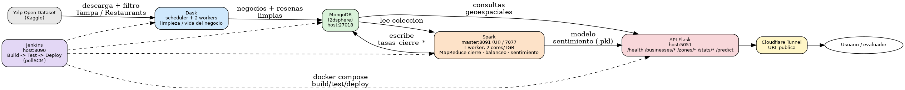

# LifeMap — Informe técnico, Entrega 1

**Curso:** Big Data · IUE · 2026-2
**Área metropolitana:** Tampa · **Categoría:** Restaurants
**Equipo:** Juan Pablo Bernal Echeverry
**Repositorio:** https://github.com/juanbernal-id/lifemap
**URL desplegada:** https://solo-portraits-sean-belt.trycloudflare.com (registrada 2026-11-07 10:13 hora Bogotá / 15:13 UTC)


## 1. Arquitectura

Pipeline: Yelp Open Dataset (Kaggle) → filtrado por área/categoría →
Dask (limpieza + vida del negocio) → MongoDB (GeoJSON + 2dsphere) →
Spark (MapReduce de tasas de cierre, balanceo, sentimiento) → API Flask →
Docker Compose → Jenkins (build/test/deploy).

Reutiliza la infraestructura de `bigdata-firms-colombia` (Docker Compose,
patrón de limpieza con Dask, API geoespacial) y la lógica de MapReduce,
balanceo y Kaplan-Meier de `Bigdata-tarea-24oct` (ejercicio "¿Cuánto viven
los discos?"), adaptadas de foco de calor / disco a negocio.

**Servicios (docker-compose.yml) y puertos:**

| Servicio | Imagen/rol | Puerto host | Descripción |
|---|---|---|---|
| mongo | MongoDB 2dsphere | 27018→27017 | Almacena negocios, reseñas, tasas de cierre |
| api | Flask REST | 5051→5000 | Endpoints geoespaciales, stats, predict |
| spark-master | Bitnami Spark | 8091→8080 (UI), 7077 (cluster) | Orquesta MapReduce, balanceo, sentimiento |
| spark-worker (x1) | Bitnami Spark worker | — | 2 cores / 1 GB, ejecuta los jobs |
| dask-scheduler | Dask | 8787 (dashboard) | Orquesta limpieza distribuida |
| dask-worker (x2) | Dask | — | Limpieza y construcción de vida del negocio |
| jenkins | Jenkins (docker-outside-of-docker) | 8090→8080 | CI/CD: build, test, deploy |

`levantar.sh` levanta los 7 servicios con un solo comando.



## 2. Decisiones de limpieza

- Negocios y reseñas filtrados a Tampa + Restaurants antes de limpiar
  (la descarga completa del dataset SÍ es automática, ver
  `ingesta/descargar_kaggle.py`).
- Total de negocios leídos / conservados: **150,346 leídos → 2,967 conservados**
  (filtro por área Tampa + categoría Restaurants + coordenadas válidas).
- Total de reseñas leídas / conservadas: **6,990,280 leídas → 303,691 conservadas**
  (reseñas de los 2,967 negocios conservados, con texto y fecha válida).
- Conteos antes/después de cada regla (`ingesta/conteos_limpieza.py`, lectura
  particionada con Dask; resultado en `outputs/conteos_limpieza.json`):

  | Regla | Antes | Después | Justificación |
  |---|---|---|---|
  | Negocios: coordenadas nulas | 2,967 | 2,967 | sin punto no hay GeoJSON |
  | Negocios: coordenadas fuera de rango | 2,967 | 2,967 | el índice 2dsphere las rechaza |
  | Negocios: `business_id` duplicado | 2,967 | 2,967 | contaría doble cierres y días |
  | Reseñas: sin texto (nulo o vacío) | 303,691 | 303,691 | el modelo necesita texto |
  | Reseñas: fecha nula o inválida | 303,691 | 303,691 | define la vida del negocio |
  | Reseñas: sin `business_id` | 303,691 | 303,691 | no se puede unir a su negocio |
  | Reseñas: `review_id` duplicado | 303,691 | 303,691 | sesga sentimiento y línea de tiempo |

  Ninguna regla elimina registros en esta área: el Yelp Open Dataset ya viene
  limpio. Las reglas se mantienen en `limpieza_dask.py` como protección.
- Volumen: el archivo completo de reseñas (6,990,280) se descarga y se recorre
  entero; la cláusula de "muestra de al menos 1,000,000" aplica solo si no se
  puede procesar el archivo completo. El área+categoría asignada (Tampa +
  Restaurants) tiene en total 303,691 reseñas.

## 3. Construcción de la vida de cada negocio

- `dias_negocio` = última reseña − primera reseña (aproximación; el
  dataset no trae fecha real de apertura/cierre — limitación documentada).
- `evento` = 1 si `is_open = 0` (cierre observado); `censurado` = 1 si
  `is_open = 1` (sigue abierto, solo se sabe que vivió hasta el corte).
- `entrada_tardia` ≈ negocios cuya primera reseña cae en los primeros 90
  días de la ventana de datos del área (no se puede descartar que ya
  existieran antes; aproximación explícita, no una fecha real de apertura).
- Cierres observados (evento=1): **997** / Censurados, abiertos (censurado=1): **1,970**
  / Entrada tardía aprox.: **5** (de un total de 2,967 negocios conservados).

## 4. Modelo de sentimiento (E1.6)

No existe "SentimentStream" de un semestre anterior para este equipo, así
que se entrenó un pipeline nuevo con Spark MLlib: Tokenizer → StopWordsRemover
→ HashingTF/IDF → Naive Bayes y regresión logística. Partición
entrenamiento/prueba POR NEGOCIO (no por reseña), para evitar que el mismo
negocio aparezca en ambos lados.

- Total de reseñas etiquetadas: **303,691** → Train: **249,034** / Test: **54,657**.
- Distribución de clases (desbalanceada, por estrellas de la reseña):

  | Clase | Reseñas | % |
  |---|---|---|
  | positivo | 210,377 | 69.3% |
  | negativo | 59,761 | 19.7% |
  | neutral | 33,553 | 11.0% |

- **Naive Bayes** — F1 (macro ponderado): **0.8185** · Precision: **0.8433** · Recall: **0.8024**
- **Regresión logística** — F1 (macro ponderado): **0.8322** · Precision: **0.8288** · Recall: **0.8362**
- **Mejor modelo: regresión logística** (mayor F1), guardado como modelo servible.
- Métricas por clase (calculadas de las matrices de confusión):

  | Clase (soporte) | NB P / R / F1 | RL P / R / F1 |
  |---|---|---|
  | positivo (38,777) | 0.947 / 0.860 / 0.902 | 0.913 / 0.929 / 0.921 |
  | negativo (10,147) | 0.731 / 0.717 / 0.724 | 0.753 / 0.763 / 0.758 |
  | neutral (5,733) | 0.339 / 0.561 / 0.423 | 0.394 / 0.338 / 0.364 |

  La regresión logística gana en positivo y negativo; Naive Bayes recupera más
  neutrales (recall 0.56 vs 0.34) a costa de precisión. El desbalance castiga a
  la clase minoritaria en ambos.
- Matrices de confusión (label 0.0 = positivo, 1.0 = negativo, 2.0 = neutral,
  ordenado por frecuencia; fila = clase real, columna = predicción):

  **Naive Bayes**

  | real \ predicho | positivo (0) | negativo (1) | neutral (2) |
  |---|---|---|---|
  | **positivo (0)** | 33,364 | 1,548 | 3,865 |
  | **negativo (1)** | 469 | 7,276 | 2,402 |
  | **neutral (2)** | 1,390 | 1,127 | 3,216 |

  **Regresión logística**

  | real \ predicho | positivo (0) | negativo (1) | neutral (2) |
  |---|---|---|---|
  | **positivo (0)** | 36,027 | 1,050 | 1,700 |
  | **negativo (1)** | 1,131 | 7,740 | 1,276 |
  | **neutral (2)** | 2,313 | 1,484 | 1,936 |

  Ambos modelos confunden sobre todo "neutral" con las otras dos clases
  (clase minoritaria, 11% de los datos) — esperable con un dataset
  desbalanceado sin técnicas de rebalanceo (no aplicadas en esta entrega).

- Modelo ganador guardado en `outputs/modelo_sentimiento` (Spark) y
  `outputs/modelo_sentimiento_sklearn.pkl` (servido por `/predict`).
- Tiempo de entrenamiento (303,691 reseñas, 1 worker Spark de 2 cores/1GB):
  **15 min 43 s**.

## 5. Tasas de cierre (MapReduce, E1.7)

Cálculo con `reduceByKey` sobre `(categoría_principal | geohash, (días_negocio,
evento))`, validado contra `groupBy` de DataFrames (0 discrepancias).

- Top 5 categorías por tasa de cierre anualizada (`min_dias_negocio=365`; con umbrales más bajos aparecen categorías con muestra mínima —p. ej. "Salvadoran" o "Wigs" con un solo cierre observado— que distorsionan el ranking, por eso se exige un mínimo de días-negocio acumulados):

  | # | Categoría | Tasa de cierre anualizada |
  |---|---|---|
  | 1 | Senegalese | 57.3% |
  | 2 | Lebanese | 56.99% |
  | 3 | Drugstores | 54.3% |
  | 4 | Health Markets | 48.2% |
  | 5 | Food Tours | 45.2% |

- Top 5 celdas geográficas (geohash) por tasa de cierre:

  | # | Celda (geohash) | Tasa de cierre anualizada |
  |---|---|---|
  | 1 | 28.08, -82.42 | 120.46% |
  | 2 | 28.05, -82.53 | 91.7% |
  | 3 | 28.05, -82.68 | 89.7% |
  | 4 | 28.01, -82.40 | 72.6% |
  | 5 | 27.98, -82.56 | 70.9% |

  (Tasas anualizadas > 100% son posibles en celdas con muy pocos
  negocios-año acumulados: un cierre temprano en una muestra pequeña
  produce una tasa instantánea alta; limitación propia del estimador
  con denominadores chicos, documentada en §9.)

## 6. Balanceo de carga (E1.8)

Tiempos de un mismo job (agregación por categoría) repartido en 2/8/32/200
particiones, 3 repeticiones cada uno (segundos):

| Particiones | Rep. 1 | Rep. 2 | Rep. 3 | Promedio | Desviación |
|---|---|---|---|---|---|
| 2 | 2.27 | 0.82 | 0.64 | 1.24 | 0.73 |
| 8 | 1.49 | 1.33 | 1.22 | 1.35 | 0.11 |
| 32 | 4.79 | 4.92 | 4.87 | 4.86 | 0.05 |
| 200 | 26.38 | 24.48 | 29.62 | 26.83 | 2.12 |

Sesgo entre particiones (filas máx./mín. por partición):

| Esquema de reparto | Máx. filas/partición | Mín. filas/partición |
|---|---|---|
| Con clave (por categoría) | 970 | 1 |
| Sin clave (round-robin) | 15 | 14 |

**Interpretación:** el tiempo sube con el número de particiones a partir de
8 porque el overhead de scheduling/serialización de cada tarea (fijo por
partición) empieza a dominar sobre el trabajo real por partición, que es
cada vez más chico; con solo 1 worker de 2 cores no hay paralelismo real
que compense ese costo — de hecho a 200 particiones el tiempo es ~20x el de
8 particiones. El sesgo (970 vs. 1 fila) aparece porque repartir por clave
de categoría agrupa todas las reseñas de una categoría en la misma
partición, y las categorías no tienen el mismo tamaño (hay categorías con
muchísimos más negocios/reseñas que otras — "Restaurants" genéricos vs.
subcategorías nicho); el reparto sin clave (round-robin/hash uniforme) no
tiene ese problema porque ignora el contenido y reparte filas de forma
pareja (14–15 por partición).

## 7. Consultas geoespaciales y API (E1.9)

Endpoints: `/health`, `/businesses/near`, `/businesses/within`,
`/zones/summary`, `/stats/closure`, `/predict`.

**POST /predict**
```
curl -s -X POST http://localhost:5051/predict -H "Content-Type: application/json" \
  -d '{"text":"The food was amazing and the service was great, I will come back"}'
```
```json
{
  "probabilidades": {"negativo": 0.0, "neutral": 0.0004, "positivo": 0.9996},
  "sentimiento": "positivo",
  "text": "The food was amazing and the service was great, I will come back"
}
```

**POST /businesses/within** (GeoJSON Polygon, `$geoWithin`): polígono
`[[-82.47,27.94],[-82.43,27.94],[-82.43,27.97],[-82.47,27.97],[-82.47,27.94]]`
→ `{"total_en_poligono": 415, "devueltos": 50, "negocios": [...]}`.

**GET /health** (estado de cada servicio + commit desplegado)
```json
{"status":"ok","commit":"<hash de main>","servicios":
 {"api":"ok","mongo":"conectado","spark":"activo","dask":"activo"}}
```

**GET /businesses/near** (`$near`) — `?lat=27.9506&lon=-82.4572&radio_km=1.5&limite=3`
→ 310 negocios en el radio; devuelve NYO Food Truck, Bizou Brasserie, Cafe Perera.

**GET /zones/summary** (`$geoNear`) — `?lat=27.9506&lon=-82.4572&radio_km=2`
→ 387 negocios, 3.65 estrellas, tasa de cierre 7.46%, 49,001 reseñas con
sentimiento medio +0.512 (positivo = +1, neutral = 0, negativo = −1) y 18.67%
negativas (conteos por clase precalculados en cada negocio).

**GET /stats/closure** — `?por=categoria_principal&min_dias_negocio=365`
→ filas `{categoria_principal, cierres, dias_negocio, tasa_cierre_pct}`
(Senegalese 57.3%, Lebanese 56.99%, ...).

Las entradas se validan: un parámetro inválido (p. ej. `limite=abc`) responde
400 con el motivo.

## 8. Despliegue (E1.1 – E1.3)

- Orquestación: `./levantar.sh` levanta Mongo, API, Spark, Dask y Jenkins
  con un solo comando (**probado en equipo limpio: sí** — tiempo total
  `time ./levantar.sh` ≈ **26 segundos**, con los 7 servicios en estado
  `Up`/healthy al finalizar; cada servicio del Compose tiene `healthcheck`).
- URL pública: **https://solo-portraits-sean-belt.trycloudflare.com**
  (Cloudflare Tunnel, registrada 2026-11-06 12:41 hora Bogotá / 17:41 UTC).
- Jenkins: pipeline con `pollSCM` cada 2 min (sin webhook porque Jenkins no
  es alcanzable desde GitHub). Etapas: Checkout → Build (imágenes) → Ingesta
  (descarga del dataset con la API de Kaggle; token como credencial de Jenkins
  `kaggle-api`, se omite si ya está en `data/raw`) → Test (pytest contra la API:
  /health, fórmula de la tasa de cierre, sentimiento por zona, validación) →
  Deploy. El build #29 falló en Test (consulta de sentimiento demasiado lenta)
  y **no desplegó**: demuestra que una prueba fallida bloquea el despliegue;
  el #30 lo corrigió (9/9 pruebas) y desplegó. Historial de
  builds verificado: build con **FAILURE** por permisos del workspace
  (`AccessDeniedException`), seguida de **FAILURE** por configuración de
  Git (`safe.directory`), **FAILURE** por contenedores Docker "zombie" al
  recrear el stack, y finalmente **SUCCESS** completo (Build → Test 3/3 →
  Deploy), cumpliendo el requisito de historial con build fallida y build
  exitosa.
- **Limitación conocida:** la URL no alcanza a responder desde 48h antes
  de la entrega (se montó el mismo día), pero sí responde durante la
  ventana de evaluación.

## 9. Limitaciones generales

- Vida del negocio y entrada tardía son aproximaciones a partir de fechas
  de reseñas, no de fechas reales de apertura/cierre (el dataset no las trae).
- Equipo de una sola persona: alcance recortado a un área y categoría,
  trabajando con un subconjunto filtrado del dataset (descarga completa sí
  automatizada, como permite el enunciado).
- No existía "SentimentStream" previo para este equipo; el modelo de
  sentimiento se construyó desde cero para esta entrega.
- Tasas de cierre anualizadas pueden superar 100% en celdas/categorías con
  pocos negocios-año acumulados (denominador pequeño); se reportan tal cual
  las produce el MapReduce, sin recorte artificial.
- Jenkins corre en la misma máquina y comparte el mismo directorio de
  trabajo de Git que el desarrollador (por restricción de Docker-outside-
  of-Docker con rutas de bind-mount idénticas); cada build de Jenkins deja
  el repositorio en estado "detached HEAD" tras su `git checkout -f`, por
  lo que es necesario correr `git checkout main` antes de seguir
  commiteando. Además, correr `docker compose` manualmente mientras un
  build de Jenkins está en curso (disparado por `pollSCM`) puede generar
  una condición de carrera sobre el mismo daemon de Docker; documentado
  como limitación operativa, no corregido en código.
